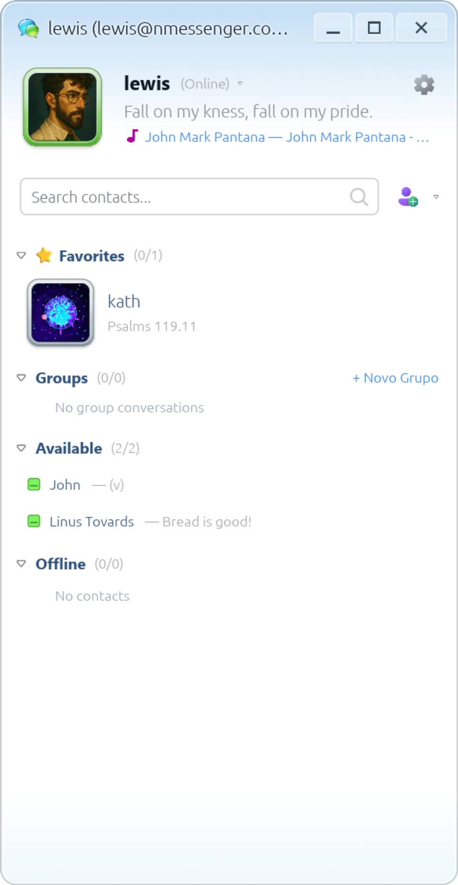
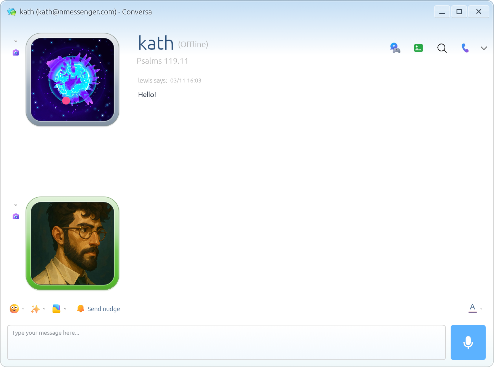

<div align="center">


# NMessenger

**English** · [Português (Brasil)](README.pt-BR.md)

**Connect. Chat. Relive.**

A native, end-to-end encrypted messaging application inspired by Windows Live Messenger — built with Rust, egui, Actix Web, and modern real-time protocols.

[](https://www.rust-lang.org/)
[](#quick-start)
[](LICENSE)
[](#system-requirements)

<br>

[Quick Start](#quick-start) · [Screenshots](#screenshots) · [Features](#features) · [Documentation](docs/README.md) · [Building & Releases](docs/releases.md) · [Security](docs/security.md)

</div>

---

NMessenger brings back the expressive, nostalgic interface of the golden era of 2000s instant messengers, backed by a modern, high-performance, and secure infrastructure. It features a native desktop and mobile client written in **Rust/egui**, an **Actix Web** backend, **PostgreSQL**, **Redis**, and a unified typed Rust protocol.

> [!NOTE]
> Interface localization is in progress: the sign-in screen and core navigation support system language detection (with Portuguese and English available); other screens and server notices remain in Portuguese.
>
> NMessenger uses its own independent protocol. It is **not** interoperable with the historical Microsoft Messenger network, MSNP, or Escargot servers.

---

## Screenshots

<div align="center">

|                                 Contact List                                  |                               Chat & Conversations                                |
| :---------------------------------------------------------------------------: | :-------------------------------------------------------------------------------: |
|  |  |

</div>

---

## Features

| Category               | Description                                                                                                               |
| :--------------------- | :------------------------------------------------------------------------------------------------------------------------ |
| 💬 **Messaging**       | Direct messages, group chats, persistent chat history, local message search, and offline delivery.                        |
| 🔒 **E2EE Privacy**    | End-to-end encryption for private messages and attachments, with cryptographic keys secured locally in an identity vault. |
| 🎨 **Personalization** | Custom profile cards, achievement badges, custom avatars, scenes, and animated emoticons.                                 |
| ⚡ **Interactivity**   | Nudges (window shaking with sound), voice notes, file transfers, and delivery receipts.                                   |
| 🎮 **Activities**      | **Game space** for real-time turn-based multiplayer games, plus integrated voice and video calls.                         |
| 🖥️ **Screen Sharing**  | Native real-time **screen sharing** for Linux/X11 sessions.                                                               |
| 🤖 **Bot Ecosystem**   | Dedicated bot accounts and a Rust SDK for sending and receiving encrypted messages through the API.                       |

---

## System Requirements

- **Rust & Cargo**: Stable toolchain (the container build uses Rust 1.98+).
- **Docker & Docker Compose**: For local services and isolated test dependencies.
- **Linux Desktop Libraries**:
  - OpenGL, X11/Wayland, and ALSA audio dependencies.
  - On Debian / Ubuntu:
    ```sh
    sudo apt install build-essential pkg-config libasound2-dev libudev-dev \
      libxkbcommon-dev libwayland-dev libx11-dev libgl1-mesa-dev
    ```
- **Media & Screen Sharing**:
  - `ffmpeg` for webcam capture and streaming.
  - For screen sharing: requires `xdotool` and an active X11 desktop session.

---

## Quick Start

### 1. Run with Docker Compose (Recommended)

```sh
# Copy default environment variables
cp .env.example .env

# Start database, cache, and backend server
make up

# Launch the desktop client
make client
```

Register an account in the sign-in window and connect to `http://127.0.0.1:18087`. Launch a second client to create another account and test friend requests, direct chats, and calls.

To stop the services while preserving persistent data:

```sh
make down
```

<details>
<summary><b>Running the Backend Directly on the Host (outside Docker)</b></summary>

If you want to run `nm-servo` directly on the host machine while keeping PostgreSQL and Redis containerized:

```sh
# Start only PostgreSQL and Redis
make infra

# Export environment variables and run the server
set -a; . ./.env; set +a
make server
```

</details>

<details>
<summary><b>Building the Client Without Native Audio</b></summary>

For environments without audio servers or ALSA drivers:

```sh
cargo run -p nmessenger-client --no-default-features
```

</details>

---

## Building

To compile optimized release binaries for both the server and desktop client:

```sh
# Compile server and desktop client into target/release/
make build

# Or compile each component independently:
make build-server
make build-client
```

---

## Android APK

The Android build pipeline runs natively on Linux x86-64 **without requiring Gradle**.

### Prerequisites

- JDK with `javac` and `keytool` available in `PATH`.
- Python 3 and Rust.
- Android SDK Build Tools 35+ (with `aapt2`, `d8`, `zipalign`, and `apksigner`).
- Android 35 SDK Platform and Android NDK.
- Environment variables `ANDROID_HOME` (or `ANDROID_SDK_ROOT`) and optionally `ANDROID_NDK_HOME`.

### Building the Development APK

```sh
# Add the ARM64 Android target
rustup target add aarch64-linux-android

# Verify build environment prerequisites
make android-check

# Build development APK signed with a local debug key
make android

# Install directly to a connected device via ADB
adb install -r target/android/nmessenger-arm64-v8a-debug-development.apk
```

> [!TIP]
> The APK targets Android 8.0 (API 26+) or newer on ARM64 devices.
> For desktop x86_64 emulators:
>
> ```sh
> rustup target add x86_64-linux-android
> make android ANDROID_ARGS="--arch x86_64"
> ```

<details>
<summary><b>Signing a Production Release APK</b></summary>

To build an aligned, production-signed APK ready for distribution, set your keystore credentials:

```sh
export NM_ANDROID_KEYSTORE=/path/to/release.keystore
export NM_ANDROID_KEY_ALIAS=your-key-alias
export NM_ANDROID_STOREPASS=your-keystore-password
export NM_ANDROID_KEYPASS=your-key-password

make android-release
```

The signed artifact will be generated at:
`target/android/nmessenger-arm64-v8a-release-production.apk`.

</details>

---

## GitHub Release Webhook & Updater

The server includes an endpoint to receive official release webhooks from the `lewisHeart/nmessenger` repository:

- Set `GITHUB_WEBHOOK_SECRET` to a random secret of at least 32 characters on the backend.
- Configure a GitHub webhook for the `release` event pointing to `https://YOUR_DOMAIN/v1/webhooks/github`.
- Webhook payloads verify GitHub's HMAC-SHA256 signature and record published release information.
- Connected clients receive instant release notifications over WebSocket and can query `/v1/releases/latest`.

---

## Configuration & Deployment

Copy `.env.example` to `.env` and configure settings for your environment.

- **Default Local Ports**:
  - NMessenger API: `18087`
  - PostgreSQL: `54329`
  - Redis: `63799`
- Detailed server configuration is documented in [`nm-servo/README.md`](nm-servo/README.md).

### Production HTTPS Deployment

To deploy in production with automatic TLS certificates via Caddy:

```sh
# 1. Set strong passwords and your domain in .env:
# POSTGRES_PASSWORD=...
# REDIS_PASSWORD=...
# NM_DOMAIN=messenger.your-domain.com

# 2. Start using the production Compose profile:
docker compose -f compose.yaml -f compose.production.yaml up -d --build
```

---

## Security and Privacy

- **Local Identity Vault**: Cryptographic device keys are generated client-side and stored in a local vault encrypted with the account password (`NM_CONFIG_DIR`).
- **Recovering Older Messages**:
  To decrypt past messages on a new device, open **Options → Privacy → Recover older messages** on the original device and export your encrypted identity. Import that file on the new device using the original password to unlock past decryption keys.
- **Strict HTTPS/WSS**: Remote servers require HTTPS/WSS connections; unencrypted HTTP is accepted solely on loopback addresses (`127.0.0.1`).

---

## Project Structure

```
nmessenger/
├── nm-protocol/          # Shared HTTP, WebSocket types, events, and data models
├── nm-servo/             # Actix Web backend, consolidated SQLx migrations, and tests
├── nmessenger-client/    # egui interface, networking, encryption, media, and bot SDK
├── scripts/              # Android build automation, auditing, and asset packaging
├── deploy/               # Caddyfile configuration, desktop entries, and icons
├── assets/               # Logos, promotional graphics, and application screenshots
└── compose.yaml          # Containerized local dependencies and test infrastructure
```

---

## Testing

The codebase includes automated unit and integration tests run against isolated services:

```sh
# Formatting, Clippy, and source size limits
make check

# Workspace tests with dedicated test database and Redis
make test

# Stop test infrastructure containers
make test-stop
```

<details>
<summary><b>Graphical UI Smoke Test</b></summary>

To run automated desktop interface smoke tests with virtual display rendering:

```sh
make smoke
```

_Requires `Xvfb`, `xdotool`, `ffmpeg`, `Python 3`, and PostgreSQL client utilities._

</details>

---

## Documentation

| Guide                                         | Read About                                                             |
| :-------------------------------------------- | :--------------------------------------------------------------------- |
| [Architecture & Design](docs/architecture.md) | Client-server architecture, workspace crates, and real-time protocols  |
| [Security & Privacy](docs/security.md)        | End-to-end encryption (E2EE), identity vault, and key recovery         |
| [Development](docs/development.md)            | Local workstation setup, prerequisites, running tests, and smoke tests |
| [Operations & Hosting](docs/operations.md)    | Production server setup, Docker Compose, Caddy TLS, and backups        |
| [Building & Releases](docs/releases.md)       | Multiplatform build matrix, AppImage, Flatpak, NSIS, and Android APKs  |
| [Bot SDK](docs/bots.md)                       | Creating bots, token authentication, and the Rust bot SDK              |

Browse the complete [documentation index](docs/README.md).

---

## License

This project is licensed under the [MIT License](LICENSE).

Third-party bundled assets retain their respective licenses and attribution as described in their resource folders.

---

<div align="center">

Enjoying NMessenger? You can [support the project on Ko-fi](https://ko-fi.com/lauel).

</div>
