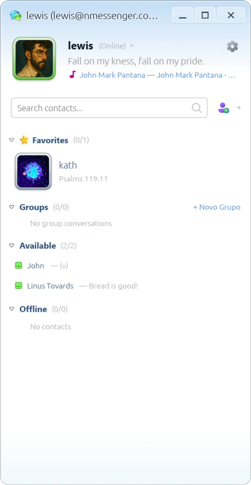
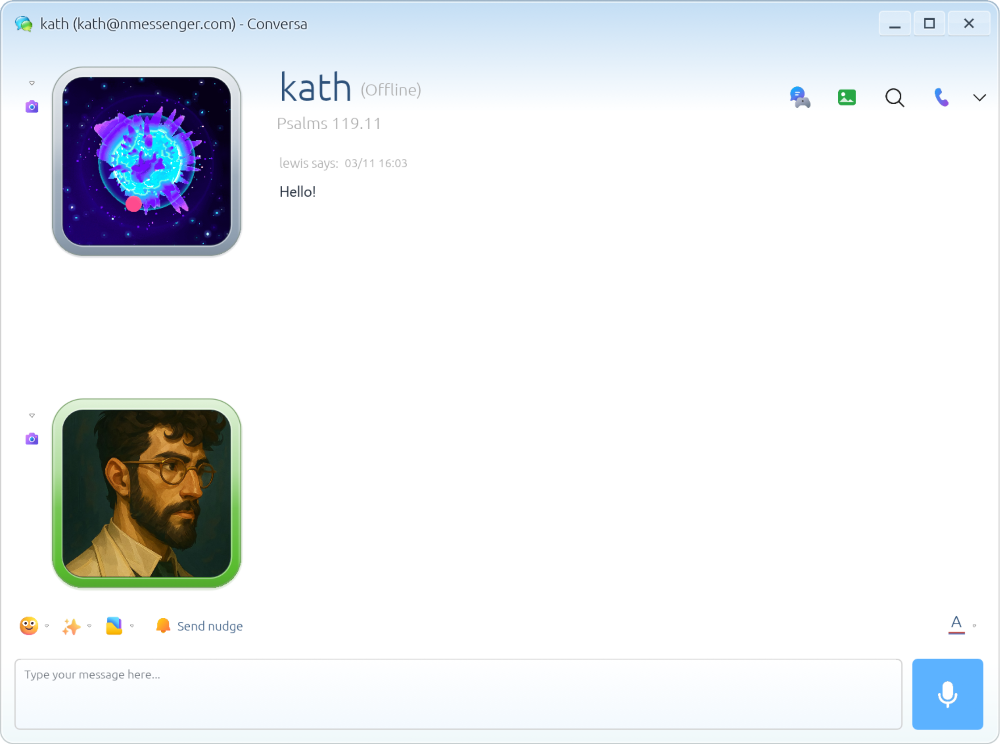

<div align="center">


# NMessenger

[English](README.md) · **Português (Brasil)**

**Conecte-se. Converse. Reviva.**

Um aplicativo de mensagens nativo com criptografia de ponta a ponta (E2EE), inspirado na era clássica do Windows Live Messenger — desenvolvido em Rust, egui, Actix Web e protocolos modernos em tempo real.

[](https://www.rust-lang.org/)
[](#início-rápido)
[](LICENSE)
[](#requisitos-do-sistema)

<br>

[Início Rápido](#início-rápido) · [Capturas de Tela](#capturas-de-tela) · [Recursos](#recursos) · [Documentação](docs/README.md) · [Compilação & Releases](docs/releases.md) · [Segurança](docs/security.md)

</div>

---

O NMessenger resgata a interface nostálgica e expressiva dos comunicadores instantâneos dos anos 2000, sustentado por uma infraestrutura moderna, segura e de alto desempenho. O projeto combina um cliente desktop e móvel nativo em **Rust/egui**, um servidor backend em **Actix Web**, **PostgreSQL**, **Redis** e um protocolo unificado fortemente tipado.

> [!NOTE]
> A localização da interface está em andamento: a tela de login e a navegação principal já suportam detecção de idioma (com português e inglês disponíveis); demais telas e avisos do servidor permanecem em português por padrão.
> 
> O NMessenger utiliza um protocolo próprio e independente. Ele **não** é interoperável com a rede histórica do Microsoft Messenger, MSNP ou servidores Escargot.

---

## Capturas de Tela

<div align="center">

| Lista de Contatos | Janela de Conversa |
| :---: | :---: |
|  |  |

</div>

---

## Recursos

| Categoria | Descrição |
| :--- | :--- |
| 💬 **Mensagens** | Conversas diretas, grupos, histórico persistente, busca local de mensagens e entrega offline. |
| 🔒 **Privacidade E2EE** | Criptografia de ponta a ponta para mensagens privadas e anexos, com chaves protegidas localmente no cofre de identidade. |
| 🎨 **Personalização** | Cartões de perfil, biografia estilo Orkut, medalhas de conquista, avatares customizados, temas/cenas e emoticons animados. |
| ⚡ **Interatividade** | Chamar a atenção (tremer a janela com som), mensagens de voz, transferência de arquivos e confirmações de entrega. |
| 🎮 **Jogos & Atividades** | **Espaço para jogos** multiplayer em tempo real por turnos, além de chamadas de voz e vídeo integradas. |
| 🖥️ **Compartilhamento de Tela** | **Compartilhamento de tela** nativo em tempo real para sessões Linux/X11. |
| 🤖 **Ecossistema de Bots** | Contas dedicadas para bots e SDK em Rust para envio e recebimento de mensagens criptografadas via API. |

---

## Requisitos do Sistema

- **Rust & Cargo**: Ferramental estável (o build em contêiner utiliza Rust 1.98+).
- **Docker & Docker Compose**: Para serviços locais e infraestrutura isolada de testes.
- **Bibliotecas Desktop Linux**:
  - Dependências de OpenGL, X11/Wayland e áudio ALSA.
  - No Debian / Ubuntu:
    ```sh
    sudo apt install build-essential pkg-config libasound2-dev libudev-dev \
      libxkbcommon-dev libwayland-dev libx11-dev libgl1-mesa-dev
    ```
- **Mídia & Compartilhamento de Tela**:
  - `ffmpeg` para captura de webcam e streaming.
  - Para compartilhamento de tela: requer `xdotool` e uma sessão desktop X11 ativa.

---

## Início Rápido

### 1. Executando com Docker Compose (Recomendado)

```sh
# Copie as variáveis de ambiente padrão
cp .env.example .env

# Inicie o banco de dados, cache e o servidor backend
make up

# Inicie o cliente desktop
make client
```

Cadastre uma conta na janela de login e conecte-se a `http://127.0.0.1:18087`. Abra uma segunda instância do cliente para criar outra conta e testar solicitações de amizade, mensagens e chamadas.

Para parar os serviços preservando os dados persistentes:
```sh
make down
```

<details>
<summary><b>Executando o Backend Diretamente no Host (fora do Docker)</b></summary>

Caso queira executar o `nm-servo` diretamente na sua máquina enquanto mantém PostgreSQL e Redis no Docker:

```sh
# Inicie apenas o PostgreSQL e o Redis
make infra

# Exporte as variáveis de ambiente e suba o servidor
set -a; . ./.env; set +a
make server
```
</details>

<details>
<summary><b>Compilando o Cliente Sem Áudio Nativo</b></summary>

Para ambientes sem servidor de som ou drivers ALSA:
```sh
cargo run -p nmessenger-client --no-default-features
```
</details>

---

## Compilação

Para compilar binários de produção otimizados para o servidor e cliente desktop:

```sh
# Compila servidor e cliente desktop em target/release/
make build

# Ou compile cada componente individualmente:
make build-server
make build-client
```

---

## APK Android

O pipeline de compilação para Android é executado nativamente no Linux x86-64 **sem necessidade de Gradle**.

### Pré-requisitos
- JDK com `javac` e `keytool` disponíveis no `PATH`.
- Python 3 e Rust.
- Android SDK Build Tools 35+ (com `aapt2`, `d8`, `zipalign` e `apksigner`).
- Plataforma Android SDK 35 e Android NDK.
- Variáveis de ambiente `ANDROID_HOME` (ou `ANDROID_SDK_ROOT`) e opcionalmente `ANDROID_NDK_HOME`.

### Compilando o APK de Desenvolvimento

```sh
# Adicione o target Android ARM64
rustup target add aarch64-linux-android

# Verifique os pré-requisitos do ambiente
make android-check

# Compile o APK de desenvolvimento assinado com chave de depuração local
make android

# Instale diretamente em um dispositivo conectado via ADB
adb install -r target/android/nmessenger-arm64-v8a-debug-development.apk
```

> [!TIP]
> O APK tem como alvo o Android 8.0 (API 26+) ou superior em dispositivos ARM64.
> Para emuladores x86_64 desktop:
> ```sh
> rustup target add x86_64-linux-android
> make android ANDROID_ARGS="--arch x86_64"
> ```

<details>
<summary><b>Assinando um APK de Produção (Release)</b></summary>

Para gerar um APK alinhado e assinado para distribuição, defina as credenciais da sua keystore:

```sh
export NM_ANDROID_KEYSTORE=/caminho/para/release.keystore
export NM_ANDROID_KEY_ALIAS=seu-alias-de-chave
export NM_ANDROID_STOREPASS=sua-senha-da-keystore
export NM_ANDROID_KEYPASS=sua-senha-da-chave

make android-release
```

O arquivo assinado será gerado em:
`target/android/nmessenger-arm64-v8a-release-production.apk`.
</details>

---

## Webhook de Releases do GitHub & Atualizador

O servidor possui um endpoint para receber webhooks oficiais de lançamentos do repositório `lewisHeart/nmessenger`:

- Configure `GITHUB_WEBHOOK_SECRET` com um segredo aleatório de pelo menos 32 caracteres no backend.
- Adicione um webhook no GitHub para o evento `release` apontando para `https://SEU_DOMINIO/v1/webhooks/github`.
- As requisições verificam a assinatura HMAC-SHA256 do GitHub e registram as informações das novas versões.
- Os clientes conectados recebem notificações imediatas via WebSocket e podem consultar `/v1/releases/latest`.

---

## Configuração & Implantação

Copie `.env.example` para `.env` e configure conforme seu ambiente.

- **Portas Padrão Locais**:
  - API NMessenger: `18087`
  - PostgreSQL: `54329`
  - Redis: `63799`
- A documentação detalhada de configuração do servidor está em [`nm-servo/README.md`](nm-servo/README.md).

### Implantação de Produção com HTTPS

Para implantar em produção com certificados TLS automáticos via Caddy:

```sh
# 1. Defina senhas fortes e seu domínio no .env:
# POSTGRES_PASSWORD=...
# REDIS_PASSWORD=...
# NM_DOMAIN=messenger.seu-dominio.com

# 2. Inicie utilizando o perfil de produção do Docker Compose:
docker compose -f compose.yaml -f compose.production.yaml up -d --build
```

---

## Segurança e Privacidade

- **Cofre de Identidade Local**: Chaves criptográficas do dispositivo são geradas no cliente e armazenadas em um cofre local protegido pela senha da conta (`NM_CONFIG_DIR`).
- **Recuperação de Mensagens Antigas**:
  Para decifrar mensagens anteriores em um novo dispositivo, abra **Opções → Privacidade → Recuperar mensagens antigas** no dispositivo de origem e exporte sua identidade criptografada. Em seguida, importe esse arquivo no novo dispositivo informando a senha original.
- **HTTPS/WSS Estrito**: Servidores remotos exigem conexões seguras HTTPS/WSS; HTTP não criptografado é aceito exclusivamente em conexões loopback (`127.0.0.1`).

---

## Estrutura do Projeto

```
nmessenger/
├── nm-protocol/          # Tipos HTTP/WebSocket compartilhados, eventos e modelos
├── nm-servo/             # Backend Actix Web, migrações SQLx consolidadas e testes
├── nmessenger-client/    # Interface egui, rede, criptografia, mídia e SDK para bots
├── scripts/              # Automação de build Android, auditoria e empacotamento
├── deploy/               # Configuração do Caddyfile, arquivos .desktop e ícones
├── assets/               # Logos, ilustrações promocionais e capturas de tela do app
└── compose.yaml          # Dependências locais em contêineres e infraestrutura de teste
```

---

## Testes

O projeto conta com baterias automatizadas de testes unitários e de integração executados em serviços isolados:

```sh
# Verificação de formatação, Clippy e limites de tamanho de arquivos
make check

# Testes do workspace com banco de dados e Redis dedicados
make test

# Encerra os contêineres da infraestrutura de testes
make test-stop
```

<details>
<summary><b>Teste de Fumaça (Smoke Test) de Interface Gráfica</b></summary>

Para executar o teste automatizado de interface com display virtual:
```sh
make smoke
```
*Requer `Xvfb`, `xdotool`, `ffmpeg`, `Python 3` e utilitários do cliente PostgreSQL.*
</details>

---

## Documentação

| Guia | Conteúdo |
| :--- | :--- |
| [Arquitetura & Design](docs/architecture.md) | Arquitetura cliente-servidor, crates do workspace e protocolos em tempo real |
| [Segurança & Privacidade](docs/security.md) | Criptografia de ponta a ponta (E2EE), cofre de identidade e recuperação de chaves |
| [Desenvolvimento](docs/development.md) | Configuração local, pré-requisitos, execução de testes e smoke tests de UI |
| [Operação & Hospedagem](docs/operations.md) | Configuração do servidor em produção, Docker Compose, Caddy TLS e backups |
| [Compilação & Releases](docs/releases.md) | Matriz multiplataforma, AppImage, Flatpak, NSIS e APKs Android |
| [SDK para Bots](docs/bots.md) | Criação de contas de bot, autenticação e SDK em Rust |

Consulte o [índice completo da documentação](docs/README.md).

---

## Licença

Este projeto é licenciado sob a [Licença MIT](LICENSE).

Arquivos e recursos de terceiros incluídos mantêm suas respectivas licenças e atribuições conforme documentado em suas pastas de recursos.

---

<div align="center">

Gostando do NMessenger? Você pode [apoiar o projeto no Ko-fi](https://ko-fi.com/lauel).

</div>

